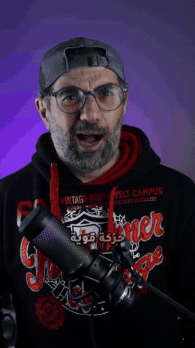
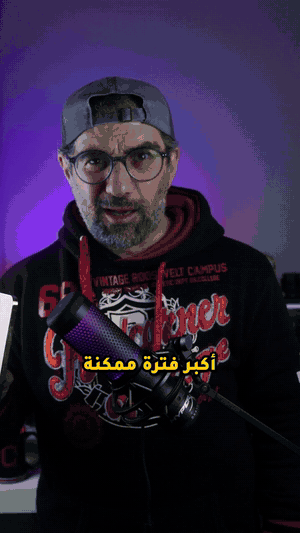
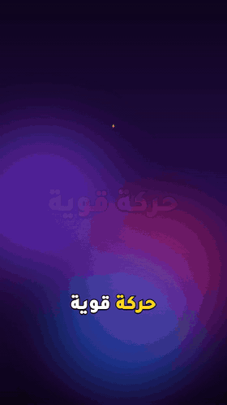
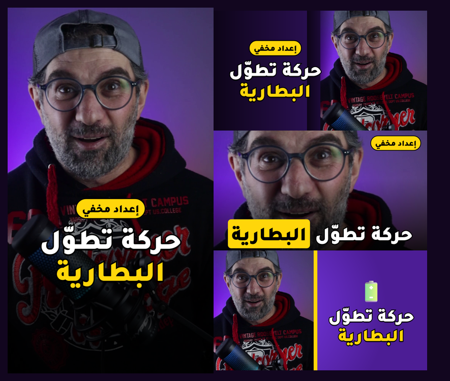

<p align="center"></p>

# ametab-video

إضافة لـ Claude Code تمنتج فيديوهات عربية على جهازك. من تطوير **Ametab Alsndi**.

## شوف وش تسوي

<table>
  <tr>
    <td align="center"><br><b>كابشن كلمة بكلمة</b><br><code>talk-reel</code></td>
    <td align="center"><br><b>إشارات على الإعدادات</b><br><code>motion-edit</code></td>
    <td align="center"><br><b>موشن وسط الفيديو</b><br><code>motion-edit</code></td>
    <td align="center"><br><b>موشن بدون تصوير</b><br><code>motion-explainer</code></td>
  </tr>
</table>

<p align="center"><br><b>كفر الريل وثلاث ثمبنيلات يوتيوب من فريم واحد</b> · <code>cover-thumb</code></p>

## السكلات
| السكل | وش يسوي |
|---|---|
| `talk-reel` | يحوّل فيديو كلام لريل 9:16: يقص السكتات، ويركّب كابشن عربي (Tajawal Black، أبيض، والكلمة اللي تنقال تصير صفراء)، ويضبط الصوت |
| `motion-edit` | مونتاج كامل بالموشن: زوم على الوجه، انتقالات فلاش، إشارات مرقّمة تنبض على الأزرار والإعدادات اللي تشرحها، مؤثرات صوتية من حزمتك، وكليبات موشن بـ Remotion وسط الفيديو |
| `cover-thumb` | كفر الريل 1080×1920 (النص داخل قص البروفايل 1:1 و3:4) وثلاث تصاميم ثمبنيل يوتيوب 1280×720 من أحلى فريم |
| `beat-montage` | مونتاج على الإيقاع من مجلد مقاطع بدون كلام: يلقى نبضات الأغنية ويقطع عليها مع ضربة زوم وفلاش |
| `review-reel` | ريل مراجعة منتج بصوتك فوق اللقطات: لقطة لكل جملة، كابشن، ملصقات سعر ومواصفات، وموسيقى تنخفض لما تتكلم |
| `podcast-cut` | بودكاست ومقابلات بأكثر من كاميرا: مزامنة من الصوت، قص على اللي يتكلم، الحلقة كاملة 16:9 أو ريلات 9:16 بهوك |
| `motion-explainer` | فيديو موشن كامل بدون تصوير: عنوان، خطوات، أرقام، مقارنة، وجوال 3D يعرض سكرين شوت مع إشارات لمس |

## المتطلبات
- [Claude Code](https://claude.com/claude-code)
- `ffmpeg` (ويندوز: `winget install Gyan.FFmpeg`، ماك: `brew install ffmpeg`)
- Python 3، و `pip install faster-whisper opencv-python numpy scipy`
- خط [Tajawal](https://fonts.google.com/specimen/Tajawal) مثبت على جهازك
- للموشن: [Node.js](https://nodejs.org) 18 أو أحدث
- للأصوات: مكتبة أو حزمة مؤثرات صوتية من عندك. الإضافة ما فيها أصوات، بس تفهرس مكتبتك وتختار منها لحالها (`motion-edit/scripts/sfx_index.py`)

## التثبيت
في Claude Code اكتب:
```
/plugin marketplace add alsndi/ametab-video
/plugin install ametab-video@ametab-video
```
أو من التطبيق: Settings ثم Plugins ثم Add marketplace، وحط `alsndi/ametab-video`.

## الاستخدام
- كابشن بس: أرسل فيديو لـ Claude وقل «منتج هالفيديو وسو منه ريل».
- مونتاج كامل: أرسل الفيديو مع حزمة الأصوات وقل «سو مونتاج كامل بأصوات وانتقالات، وأشّر على الإعدادات». وتقدر تضيف «وحط موشن بعد جملة كذا».
- كفر: «سو كفر للريل وثمبنيل يوتيوب».
- مونتاج على أغنية: أرسل مجلد مقاطع وأغنية وقل «ركّبها على الإيقاع».
- مراجعة منتج: أرسل تسجيل صوتك ومقاطع المنتج وقل «سو ريفيو بصوتي».
- بودكاست: أرسل ملفات الكاميرات وقل «منتج البودكاست» أو «طلّع ريلات من الحلقة».
- موشن بدون تصوير: أرسل تسجيل صوتك (أو فكرة) وقل «سو فيديو موشن يشرح…».

## الرخصة
MIT © 2026 Ametab Alsndi
