<p align="center">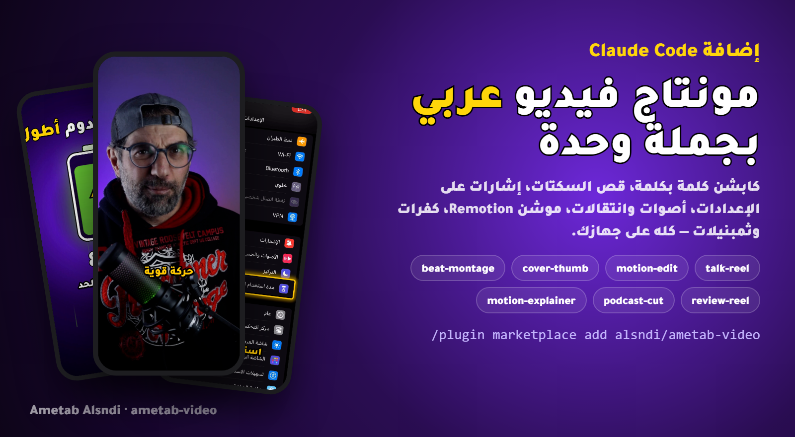</p>

# ametab-video

إضافة لـ Claude Code تمنتج فيديوهات عربية على جهازك. من تطوير **Ametab Alsndi**.

## ⚡ ابدأ في 4 خطوات

<p align="center">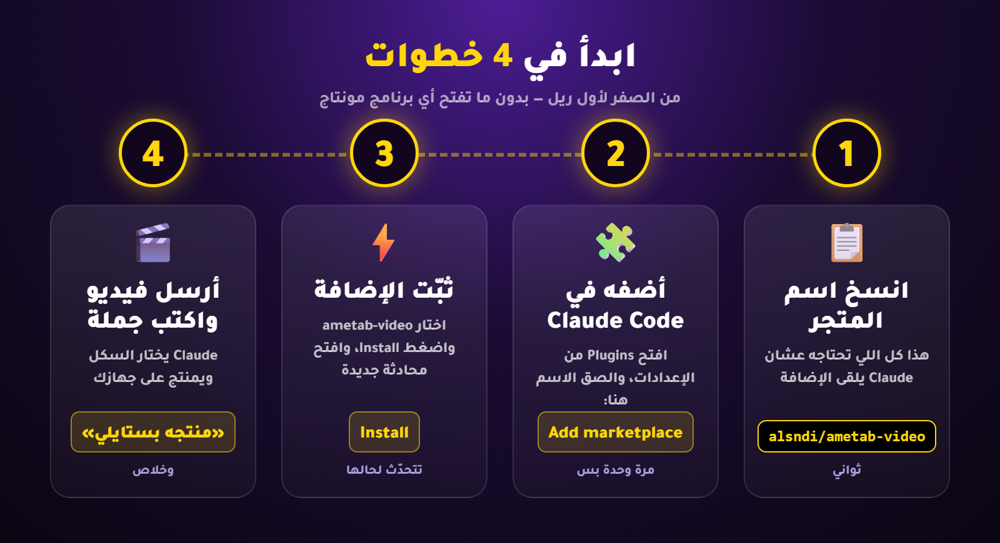</p>

**1. انسخ اسم المتجر.** زر النسخ موجود على طرف المربع:

```
alsndi/ametab-video
```

**2. أضفه في Claude Code.** افتح الإعدادات، وبعدها **Plugins**، واضغط **Add marketplace**، والصق الاسم.

**3. ثبّت الإضافة.** بتطلع لك `ametab-video` في القائمة. اضغط **Install**، وبعدها افتح محادثة جديدة.

**4. جرّبها.** أرسل فيديو تتكلم فيه، واكتب: «منتجه بستايلي، واللون أخضر». Claude يختار السكل المناسب، ويطلّع لك الريل على جهازك.

<details>
<summary><b>تحب التيرمنال؟</b> أمرين بس</summary>

```
/plugin marketplace add alsndi/ametab-video
/plugin install ametab-video@ametab-video
```
</details>

<details>
<summary><b>أول مرة؟</b> هذي الأدوات اللي تحتاجها على جهازك</summary>

السكلات تشتغل على جهازك، مو على السيرفر، عشان كذا تحتاج هالأدوات. لو وحدة منها ناقصة، Claude بيقولك ويساعدك تثبّتها:

- `ffmpeg`: على ويندوز `winget install Gyan.FFmpeg`، وعلى ماك `brew install ffmpeg`
- Python 3، وبعده `pip install faster-whisper opencv-python numpy scipy`
- خط [Tajawal](https://fonts.google.com/specimen/Tajawal)
- للموشن: [Node.js](https://nodejs.org) 18 أو أحدث
- للأصوات: مجلد مؤثرات صوتية من عندك. Claude يفهرسه مرة وحدة، وبعدها يختار منه لحاله
</details>

## شوف شنو يسوي
<table>
  <tr>
    <td align="center"><br><b>كابشن كلمة بكلمة</b><br><code>talk-reel</code></td>
    <td align="center">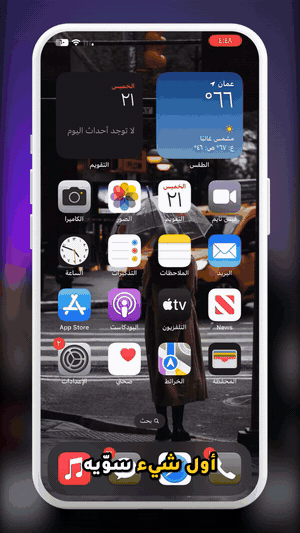<br><b>إشارات على الإعدادات</b><br><code>motion-edit</code></td>
    <td align="center"><br><b>موشن وسط الفيديو</b><br><code>motion-edit</code></td>
    <td align="center"><br><b>موشن بدون تصوير</b><br><code>motion-explainer</code></td>
  </tr>
</table>

### ستايل الاستوديو

<table>
  <tr>
    <td align="center">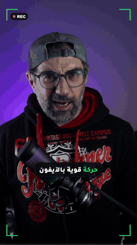<br><b>شاشة مقسومة، كروت، وقائمة صح تتعبّى</b><br><code>studio-reel</code></td>
    <td align="center">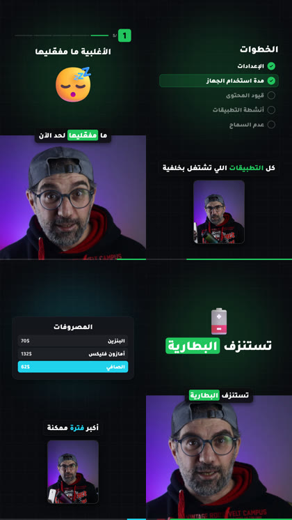<br><b>الكروت: قائمة مرقّمة، قائمة صح، جدول، وعنوان</b><br><code>studio-reel</code></td>
    <td align="center">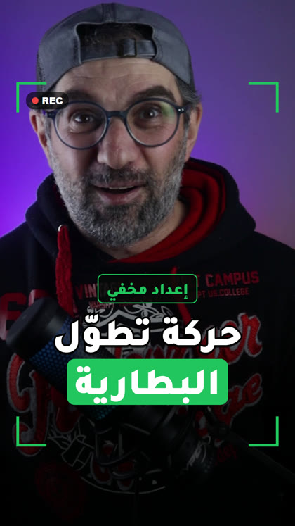<br><b>كفر بنفس الستايل: تاق، كلمة على لون، وREC</b><br><code>cover-thumb --look studio</code></td>
  </tr>
</table>

### من فيديوهاتي

مقاطع من فيديوهات سويتها قبل. منها انبنى ستايل `studio-reel`، وكل فيديو له لون حسب موضوعه.

<table>
  <tr>
    <td align="center">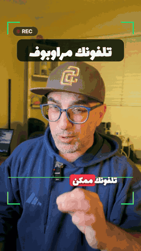<br><b>هل هاتفك مخترق؟</b><br>REC، قائمة 7 علامات، تحذير، و«شتسوي؟»</td>
    <td align="center">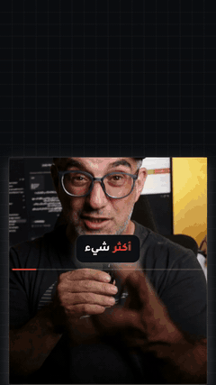<br><b>Claude يسوي جدول مصروفات</b><br>كروت الجدول تنبني قدامك</td>
    <td align="center">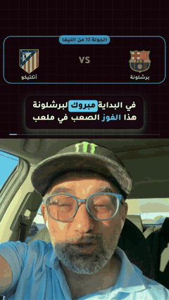<br><b>تحليل برشلونة 2-1 أتلتيكو</b><br>لوحة النتيجة وكروت التحليل</td>
  </tr>
  <tr>
    <td align="center">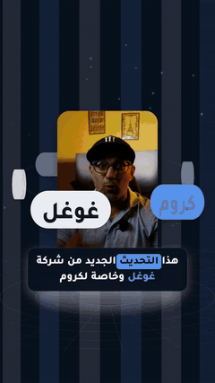<br><b>تحديث كروم الجديد</b><br>موشن الأيقونات وسكرين شوت</td>
    <td align="center">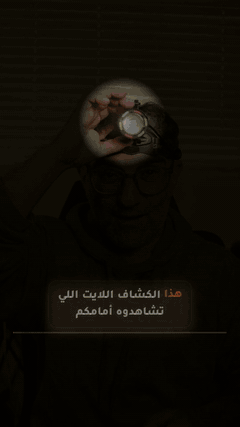<br><b>تيمو: كشاف الراس</b><br>دخلة الكشاف، عدّاد الكوبونات، والكود</td>
    <td align="center">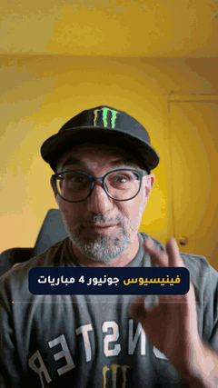<br><b>فينيسيوس موقوف 4 مباريات</b><br>عدّاد العقوبة، الأسباب، والمباريات اللي بيغيب عنها</td>
  </tr>
  <tr>
    <td align="center">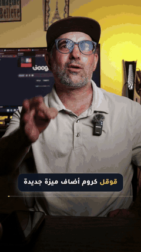<br><b>التبويب العمودي في كروم</b><br>خطوات مرقّمة بسكرين شوت، ووجهك بمربع، و«جرّبتها؟ علّق»</td>
  </tr>
</table>

<p align="center"><br><b>كفر الريل وثلاث ثمبنيلات يوتيوب من فريم واحد</b> · <code>cover-thumb</code></p>

## السكلات
| السكل | وش يسوي |
|---|---|
| `talk-reel` | يحوّل فيديو كلام لريل 9:16: يقص السكتات، ويركّب كابشن عربي (Tajawal Black، أبيض، والكلمة اللي تنقال تصير صفراء)، ويضبط الصوت |
| `motion-edit` | مونتاج كامل بالموشن: زوم على الوجه، انتقالات فلاش، إشارات مرقّمة تنبض على الأزرار والإعدادات اللي تشرحها، مؤثرات صوتية من حزمتك، وكليبات موشن بـ Remotion وسط الفيديو |
| `cover-thumb` | كفر الريل 1080×1920 (النص داخل قص البروفايل 1:1 و3:4) وثلاث تصاميم ثمبنيل يوتيوب 1280×720 من أحلى فريم |
| `beat-montage` | مونتاج على الإيقاع من مجلد مقاطع بدون كلام: يلقى نبضات الأغنية ويقطع عليها مع ضربة زوم وفلاش |
| `review-reel` | ريل مراجعة منتج بصوتك فوق اللقطات: لقطة لكل جملة، كابشن، ملصقات سعر ومواصفات، وموسيقى تنخفض لما تتكلم |
| `podcast-cut` | بودكاست ومقابلات بأكثر من كاميرا: مزامنة من الصوت، قص على اللي يتكلم، الحلقة كاملة 16:9 أو ريلات 9:16 بهوك |
| `motion-explainer` | فيديو موشن كامل بدون تصوير: عنوان، خطوات، أرقام، مقارنة، وجوال 3D يعرض سكرين شوت مع إشارات لمس |
| `studio-reel` | ستايل الاستوديو: شاشة مقسومة أو وجه بمربع صغير، كروت غامقة بلون واحد للموضوع (قائمة 2/7، قائمة صح، نتيجة مباراة، شخص، جدول)، كابشن بمربع، REC وشريط تقدم، وأصوات تلقائية من مكتبتك |

## الاستخدام
- كابشن بس: أرسل فيديو لـ Claude وقل «منتج هالفيديو وسو منه ريل».
- مونتاج كامل: أرسل الفيديو مع حزمة الأصوات وقل «سو مونتاج كامل بأصوات وانتقالات، وأشّر على الإعدادات». وتقدر تضيف «وحط موشن بعد جملة كذا».
- كفر: «سو كفر للريل وثمبنيل يوتيوب».
- مونتاج على أغنية: أرسل مجلد مقاطع وأغنية وقل «ركّبها على الإيقاع».
- مراجعة منتج: أرسل تسجيل صوتك ومقاطع المنتج وقل «سو ريفيو بصوتي».
- بودكاست: أرسل ملفات الكاميرات وقل «منتج البودكاست» أو «طلّع ريلات من الحلقة».
- موشن بدون تصوير: أرسل تسجيل صوتك (أو فكرة) وقل «سو فيديو موشن يشرح…».
- ستايل الاستوديو: «منتجه بستايلي، شاشة مقسومة وكروت، اللون أخضر». والكفر بنفس الستايل: «سو كفر ستايل الاستوديو».

## الرخصة
MIT © 2026 Ametab Alsndi
